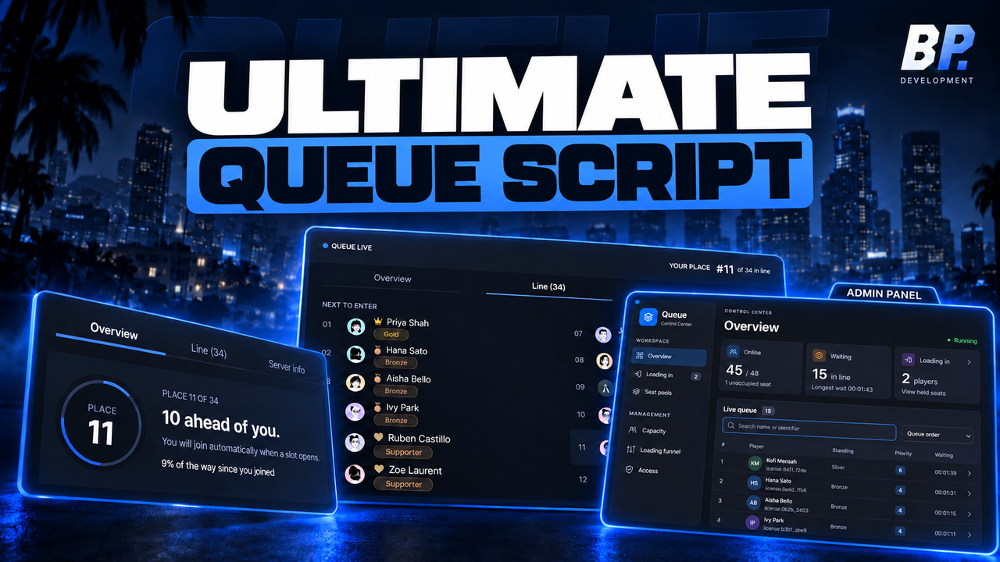
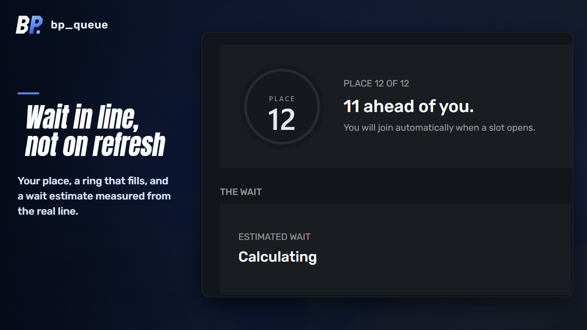
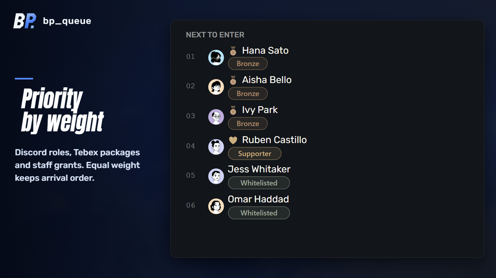
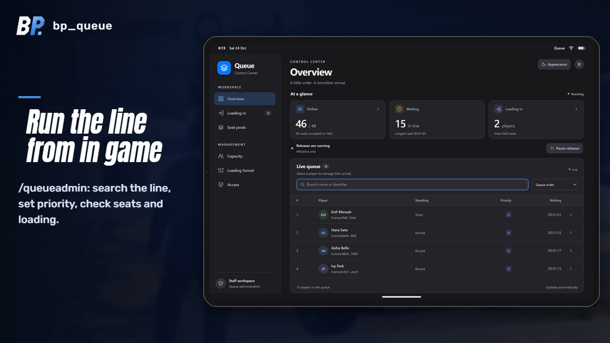
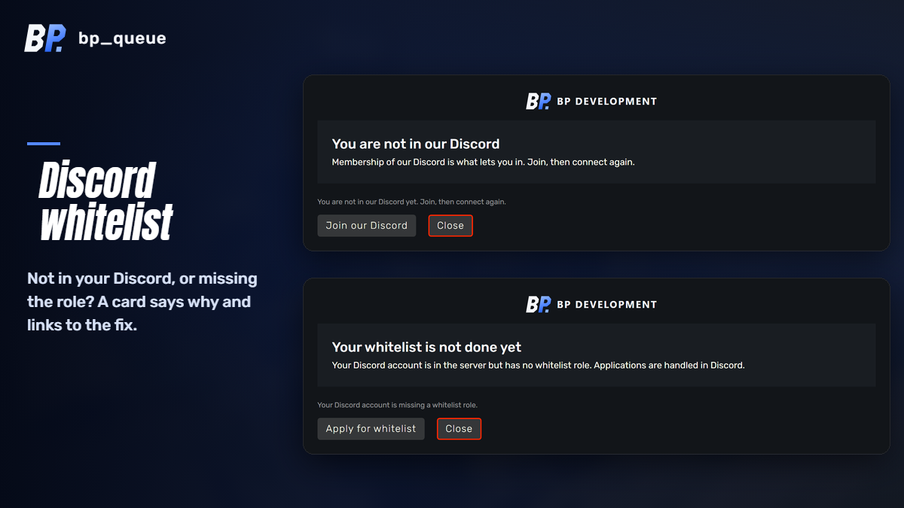
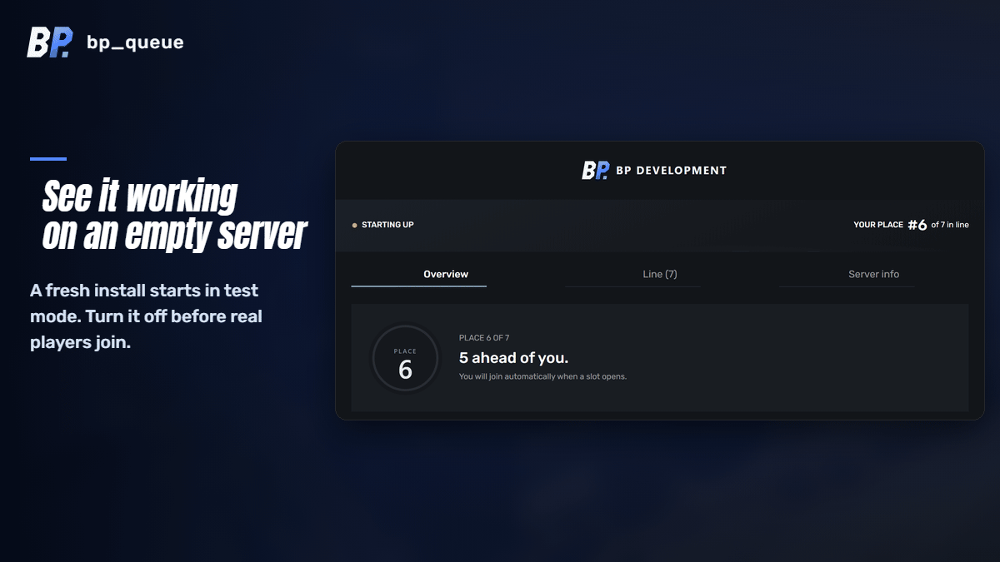

# bp_queue: FiveM queue script with Discord priority and whitelist

<b>The ConnectQueue alternative for 2026.</b> A priority queue system for QBCore, Qbox, ESX and standalone servers.

bp_queue is a FiveM queue system for servers that fill up. Players who can't get in right away wait in a ranked line instead of bouncing off a full server, and the people you want in first get in first: Discord roles, Tebex supporters, staff. It also works as a Discord whitelist, so only members of your guild, or holders of the roles you pick, get a place in line.

**[Get it on Tebex](https://tebex.bhavikp.in/fivem-scripts/lifetime-fivem-queue-system-discord-whitelist)** · [Free edition](https://tebex.bhavikp.in/free-fivem-scripts/free-fivem-queue-system) · [Documentation](https://docs.bhavikp.in/scripts/bp-queue/) · [Video walkthrough](https://www.youtube.com/watch?v=EmnrSnrk_uQ) · [Discord support](https://discord.bhavikp.in)

> This repository is the public face of bp_queue. It holds the media, the changelog, the shipped `config.lua` and the issue tracker. The script itself is delivered through the Cfx.re portal after purchase and runs under FiveM asset escrow.

## Wait in line, not on refresh

The waiting card shows your place, a ring that fills as you move up, filled seats and a wait estimate measured from the real line. A second tab pages through everybody waiting and opens on your own row. A third carries your server's about text and rules.

## Priority by weight

Weight comes from Discord roles, Tebex packages, staff grants and a short grace after a crash. Equal weight keeps arrival order, so nobody gets shuffled backwards while they wait. A purchase made while someone is already in line counts on the next re-check.

## Run the line from in game

`/queueadmin` opens a tablet where staff search the line, set priority, move or remove players, pause releases and change every setting live. Staff ranks decide who can change what.

## Refusals that explain themselves

A player who is outside your Discord, missing the role or early for whitelist hours sees why. Each reason gets its own card with a link to the fix, instead of one line of red text.

## See it working on an empty server

A fresh install starts in test mode, with pretend players in line and test buttons on the card. Turn it off before real players join.

## Features

- Weighted line with Discord role, Tebex package and staff grant priority
- Discord whitelist by guild membership or role, cached per player
- Reserved seats for staff and supporters
- Loading funnel and startup warmup for the minute after a restart
- Reconnect priority for players who crash while seated
- Job queues, so a police role only counts when someone joins as police
- Whitelist hours on a timetable
- Grants saved across restarts, to a file or MySQL
- Branded three-tab waiting card with your logo, colours, rules and Discord avatars
- Read-only HTTP bridge for a Discord bot
- Exports for other resources ([list](https://docs.bhavikp.in/scripts/bp-queue/))
- Stops `hardcap` and `connectqueue` so two systems never double-book a slot

## A ConnectQueue alternative for 2026

ConnectQueue has been the default FiveM queue script for years, and its main repository was last updated in January 2024. If you run it today, bp_queue covers the same ground and adds what servers now expect from a queue. On start it stops `connectqueue` and `hardcap` and keeps them from starting again, so you can't end up with two queues handing out the same slots.

| | ConnectQueue | bp_queue |
| --- | --- | --- |
| Priority queue | By identifier, in a Lua file or the API | Discord roles, Tebex packages, staff grants, set live |
| Whitelist | Priority-list players only | Discord guild and roles, plus whitelist hours on a timetable |
| What players see while waiting | A line of text | A three-tab card with place, wait estimate and the line |
| Refused players | One message | A card per reason with a link to the fix |
| Staff controls | Config file and restart | `/queueadmin` panel in game, with staff ranks |
| Reserved seats and loading funnel | | ✓ |
| Reconnect priority after a crash | Grace period, off by default | ✓ |
| Frameworks | Standalone | Standalone, with QBCore, Qbox, ESX and ND_Core groups read for staff ranks |

Switching takes three steps: remove `ensure connectqueue`, add `ensure bp_queue`, and set your priorities in `/queueadmin`.

## Free vs Pro

| | Free | Pro |
| --- | :---: | :---: |
| Weighted line, capacity, startup warmup, loading funnel | ✓ | ✓ |
| Crash protection (reconnect near the front) | ✓ | ✓ |
| Priority by identifier, set in the panel | ✓ | ✓ |
| In-game panel and test mode | ✓ | ✓ |
| Pause and remove players | ✓ | ✓ |
| Discord whitelist and role priority | | ✓ |
| Tebex packages that buy a place in line | | ✓ |
| Reserved seats for staff and supporters | | ✓ |
| Job queues and whitelist hours | | ✓ |
| Grants saved across restarts | | ✓ |
| Move, re-weigh and grant from the panel | | ✓ |
| Branded three-tab waiting card with logo, rules and avatars | | ✓ |
| HTTP bridge for a Discord bot | | ✓ |

Pro is sold [lifetime](https://tebex.bhavikp.in/fivem-scripts/lifetime-fivem-queue-system-discord-whitelist) or [monthly](https://tebex.bhavikp.in/fivem-scripts/fivem-queue-system-discord-whitelist-monthly). Free is a [$0 package](https://tebex.bhavikp.in/free-fivem-scripts/free-fivem-queue-system). Upgrading from Free copies your panel settings across on the first start.

## Configuration

Almost everything is set in game from `/queueadmin`. [`config.lua`](config.lua) holds only what must never reach a player's screen: the Discord bot token, the Tebex secret, bridge tokens and staff ranks. It is the same file you get in the download.

## Requirements

- A recent FiveM server artifact. No framework required: Qbox, QBCore, ESX and ND_Core are read when present
- Optional: a Discord bot token for the whitelist and role priority
- Optional: oxmysql, only if you save grants to MySQL

## Support

- Bugs: [open an issue](../../issues/new/choose) with your server artifact, framework and the console output
- Questions and setup help: [Discord](https://discord.bhavikp.in)
- Full docs: [docs.bhavikp.in/scripts/bp-queue](https://docs.bhavikp.in/scripts/bp-queue/)

## License

© BP Development. All rights reserved. The media and `config.lua` in this repository are published for reference. The script is licensed per server through Tebex and the Cfx.re portal.
